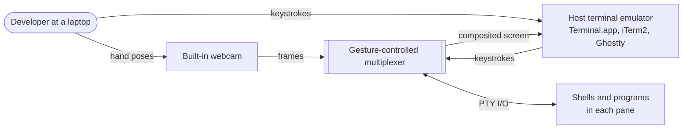
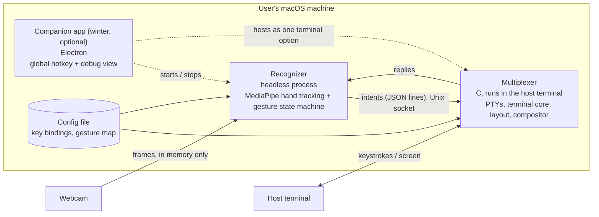
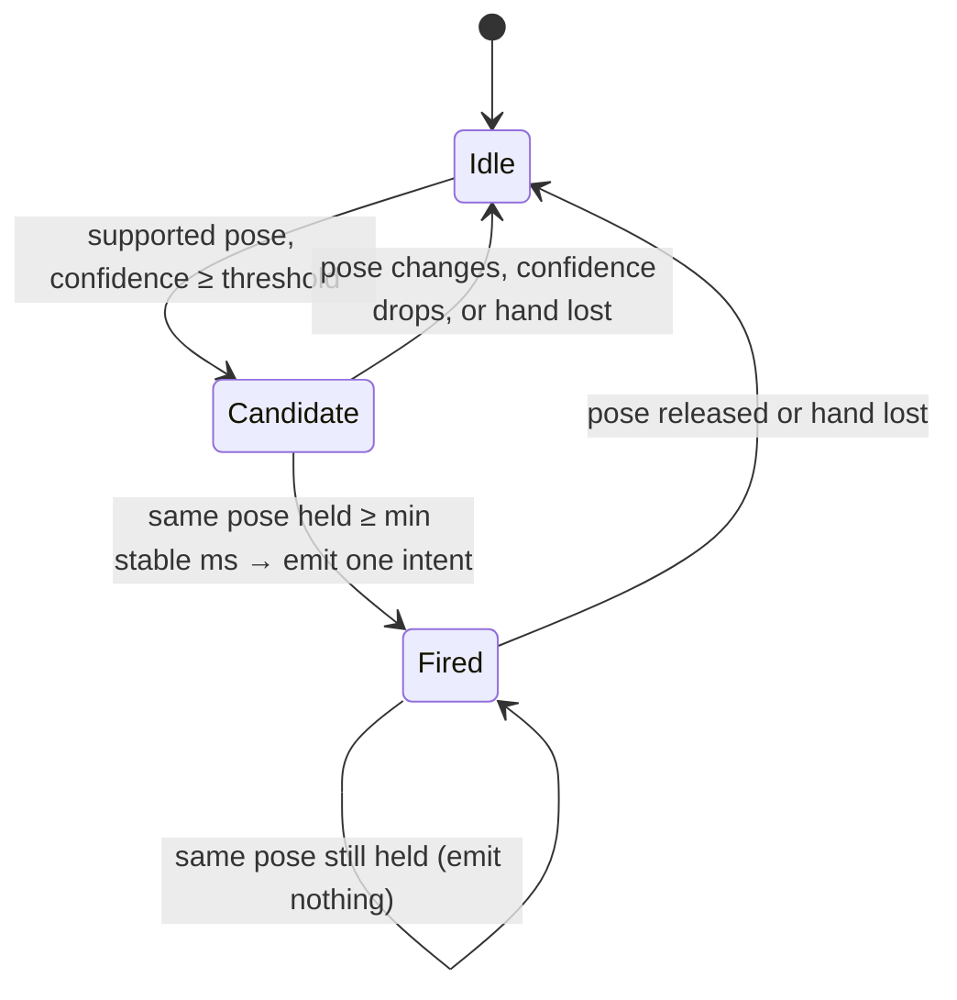
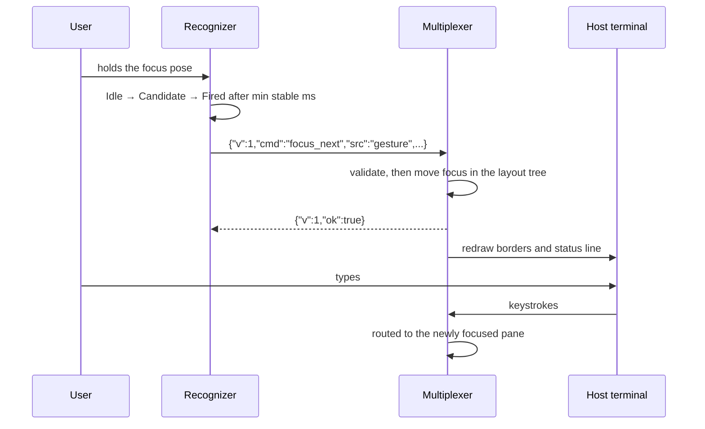

# Repo Checkpoint 1: Set Up

CS 461 Senior Capstone · Oregon State University · Fall 2026

**Project 60: Vision-Based Gesture Control for Terminal Multiplexers**
Mentor: Prof. Alexander Guyer, EECS. Student-proposed, no external partner, no NDA.

| | |
| --- | --- |
| Team | Farzaan Wadiwalla <wadiwalf@oregonstate.edu><br>Havel Konda <kondah@oregonstate.edu><br>Justin Lee <leeju8@oregonstate.edu><br>Tobias Kohn <kohnto@oregonstate.edu> |
| Date submitted | ____________________ |
| Repository | https://github.com/just1nlee/osu-capstone |
| Commit graded (full hash) | ________________________________________ |

## Milestone evidence

| Item | Status | Evidence |
| --- | --- | --- |
| CI | Met | Run on the graded commit: ____________________<br>A deliberate break turning CI red: https://github.com/just1nlee/osu-capstone/actions/runs/41408859996 |
| Board | Met | ____________________ |
| Production target | Recorded; agreement pending | `docs/design.md`, Deployment. **Not yet met:** Prof. Guyer's agreement. Owner: Justin Lee. To be met by 2026-11-03 (mentor meeting). |
| Approval | Recorded | `docs/risks.md`, R-12: mentor agreement to the production target, asked by Justin Lee on 2026-11-01. |
| Inherited-codebase audit | Not applicable | The project starts from an empty repository. |
| Staging and rollback plan | Recorded | `docs/risks.md`, Safety net plan, with landing dates. |

## Contents

1. Requirements: `docs/requirements.md`
2. Design: `docs/design.md`
3. Risk register: `docs/risks.md`
4. README: `README.md`
5. Contributing: `CONTRIBUTING.md`
6. AI context file: `AGENTS.md`

Each document below is copied unchanged from the repository at commit `0f88a3ff8092920f343a35b9539bab6525c737a5`.


<div style="page-break-before: always;"></div>

---

**File: `docs/requirements.md`**

# Requirements

Project 60: Vision-Based Gesture Control for Terminal Multiplexers. CS 461/462, Oregon State University, 2026 to 2027. Mentor: Prof. Alexander Guyer.

## Problem statement

Developers who work in a terminal multiplexer manage panes with prefix-key chords (in tmux, `Ctrl-b` then `%` to split, `Ctrl-b` then an arrow to move focus). The chords share the keyboard with the work itself, so every layout change interrupts typing, and the bindings are memorized per tool. This project tests whether deliberate hand gestures, seen by the laptop's built-in webcam, can take over pane navigation and layout while the keyboard stays on the actual work. The evidence so far is the team's own daily use of tmux and similar tools. Nobody outside the team has been observed or interviewed yet, so the problem is a hypothesis until the winter user sessions (risk R-10 in `docs/risks.md`).

## Status

No requirement below is implemented yet. The only runnable code is the scaffold in `playground/mediapipe-example`, which recognizes gestures in an Electron window but implements none of these requirements. Every requirement therefore keeps its acceptance criteria. When one is finished and a test named after it runs in CI, the test's name replaces its criteria.

**Validation.** The project has no external partner, so Prof. Guyer stands in for one. A requirement is **assumed** until the mentor or a user outside the team confirms it. Today every functional and non-functional requirement is assumed. Mark one **confirmed** in the pull request that records the confirmation, and say who confirmed it.

## Functional requirements

Priority labels use MoSCoW (Must, Should, Could), ranking how much the product needs each requirement, not the order it gets built in. Build order lives on the board.

### Recognition

- **FR-1** (Must: every gesture feature depends on it): The recognizer reads frames from the laptop's built-in webcam and reports, for each processed frame, the hand pose it sees and a confidence score.
  Acceptance: given a recorded landmark sequence for each supported pose, the recognizer reports that pose with a confidence above the configured threshold.
- **FR-2** (Must: a misfire interrupts the user's work): A low-confidence result, an unknown pose, or a frame with no hand produces no command.
  Acceptance: given a sequence of frames below the threshold, of an unsupported pose, or with tracking lost, no command is emitted.
- **FR-3** (Must: without it, one held pose fires dozens of commands): A held gesture produces exactly one command, and the same gesture fires again only after the hand releases it.
  Acceptance: holding a supported pose for 3 seconds emits one command. Releasing it and performing it again emits a second command.
- **FR-4** (Must: a stray frame must not count as a gesture): A gesture fires only after the pose stays stable for a configured minimum time, measured in milliseconds rather than frames, so it behaves the same at 15 fps and 30 fps.
  Acceptance: a pose held for less than the minimum time emits nothing. The same pose sequence replayed at 15 fps and at 30 fps emits the same commands.

### Pane control

- **FR-5** (Must: the walking skeleton is this one action): A gesture moves focus to the next pane.
  Acceptance: with two panes open and the left one focused, the focus-next gesture moves focus to the right pane, and keyboard input then goes to the right pane.
- **FR-6** (Must: the second action a user needs after focus): A gesture splits the focused pane, starts the user's login shell in the new pane, and focuses it.
- **FR-7** (Should: rearranging is in scope, but focus and split come first): A gesture switches the window to the next preset layout, without restarting any process running in a pane.
  Acceptance: a long-running process (for example `top`) keeps running, with the same process ID, before and after the layout change.
- **FR-8** (Should: closing a pane ends its process, so a misfire costs work): A gesture closes the focused pane, but only at a higher confidence threshold than navigation gestures use.
  Acceptance: a close-pane result between the navigation threshold and the destructive threshold emits no command. A result above the destructive threshold closes the pane.
- **FR-9** (Must: a malformed command must never corrupt the layout): The multiplexer rejects an unknown command, a missing or invalid field, or an unsupported protocol version, and leaves the layout unchanged.
  Acceptance: each of those four cases leaves the pane tree and the focused pane identical to their state before the command arrived.

### Keyboard and terminal

- **FR-10** (Must: the keyboard does all actual work, and the camera is optional): Every pane action that a gesture can trigger can also be triggered by a key binding. The multiplexer works fully with no camera and no recognizer running.
  Acceptance: with the recognizer stopped, key bindings split, focus, change the layout, and close panes.
- **FR-11** (Must: the user keeps the terminal they already use): The multiplexer runs inside an existing terminal emulator, and full-screen programs render correctly in its panes.
  Acceptance: in at least two terminal emulators, `vim` and `btop` render in a pane with no corrupted cells, and resizing the host window reflows the panes.

### Feedback and control

- **FR-12** (Should: a user who cannot see what was recognized cannot correct a misfire): After each command, the multiplexer shows the recognized gesture and the resulting command for at least 1 second.
- **FR-13** (Should: users need to switch off the camera without quitting their work): The user turns gesture recognition on and off with one key binding, without restarting the multiplexer. While recognition is off, the camera is released.
  Acceptance: after the toggle, the operating system's camera-in-use indicator turns off.
- **FR-14** (Could: a convenience on top of FR-13): A desktop companion app registers a system-wide hotkey that turns on the camera and opens a debug view showing the camera feed, the current gesture, and its confidence. Closing the app leaves the multiplexer running.
- **FR-15** (Could: useful, but the default mapping must work first): The user remaps which gesture triggers which command in a configuration file, and the mapping survives a restart.

## Non-functional requirements

These follow the ISO/IEC 25010 checklist. Interaction capability and flexibility are measured as success metrics instead, because they need users outside the team. The numbers marked **provisional** are the team's first estimates and get reset from the baseline of the recognizer spike (risk R-2, due 2026-11-17).

- **NFR-1** (Must: a gesture slower than the keyboard has no reason to exist), performance, provisional: From the moment a pose becomes stable, the layout change appears on screen within 300 ms at the median and 500 ms at the 95th percentile, over 50 trials on a team laptop.
- **NFR-2** (Should: users won't adopt a multiplexer that slows their output), performance: Printing a 10 MB text file in a pane takes no more than twice as long as printing it in the host terminal without the multiplexer.
- **NFR-3** (Must: below this, users stop trusting the gestures), reliability, provisional: Each supported gesture triggers its intended command in at least 90% of 20 attempts, per tester, on three different laptops under normal indoor lighting.
- **NFR-4** (Must: a misfire interrupts work), reliability, provisional: Over 30 minutes of normal keyboard work with recognition on and no gestures attempted, the recognizer emits at most one command.
- **NFR-5** (Must: video of people is the project's one sensitive asset), security: No camera frame is written to disk or sent over the network. Only labels, scores, timestamps, and derived landmark coordinates leave the recognizer.
  Acceptance: during a 10-minute session, the recognizer process opens no connection to another host and writes no image or video file.
- **NFR-6** (Must: terminal contents can include secrets), security: The channel that carries commands into the multiplexer accepts connections only from the user running it.
  Acceptance: a second local user account cannot connect to it.
- **NFR-7** (Must: the team cannot test what it cannot run without a camera), maintainability: The recognizer's command logic and the multiplexer's layout logic each run their tests in CI with no camera, no display, and no human input.
- **NFR-8** (Must: the fall deployment milestone is an outside install), compatibility: A release build installs from GitHub Releases on a macOS machine outside the team in under 15 minutes, by following the release notes alone.

## Constraints

These are limits the team did not choose and cannot drop. They carry no priority label.

- **C-1 Course schedule.** The walking skeleton must install on a machine outside the team by fall week 10 (2026-11-30 to 2026-12-06), and Repo Checkpoint 2 checks it in that week. Week 9 (2026-11-23 to 2026-11-29) is Thanksgiving week.
- **C-2 Mentor agreement.** The project is student-proposed, so the production target needs Prof. Guyer's agreement in place of a partner's (risk R-12).
- **C-3 Hardware.** Development and testing use the team members' own laptops and built-in webcams. The project has no dedicated camera hardware and no lab machine.
- **C-4 Camera data.** Video of a recognizable person may not be committed, shared, or sent to an AI tool, under the confidentiality boundary in `AGENTS.md`. Only derived coordinate output may leave the machine that captured it, so tests and fixtures use landmark data, never frames.
- **C-5 Testing with people.** Sessions with people outside the team are subject to whatever approval the course requires, which is still being confirmed (risk R-15).
- **C-6 Third-party licenses.** Every dependency, model, and dataset must carry a license that allows redistribution in a public repository and a public release.
- **C-7 macOS distribution.** macOS Gatekeeper blocks or warns on downloaded apps that are not signed and notarized. Signing requires a paid Apple Developer Program account, which nobody funds today (risk R-9).

## Success metrics

The team set these before collecting any data. Each one is measured in the winter user sessions, or at the point named.

- **SM-1 Gestures are worth using.** For a fixed task of five pane actions (split, focus, change layout, focus, close), the median gesture completion time across participants is no more than 1.5 times the median keyboard completion time for the same task in tmux. Collected with a stopwatch log per participant. Decision rule: above 1.5 times, the team rescopes the gesture set before adding anything else (risk R-10).
- **SM-2 Gestures don't get in the way.** Unintended commands average at most 1 per 30 minutes of session time, counted from the recognizer's command log (labels and timestamps only) against the participant's own report. Decision rule: above that rate, raising the confidence and stability thresholds takes priority over new gestures.
- **SM-3 Someone else can run it.** By fall week 10, at least one person outside the team installs the release build and completes the FR-5 focus action without help from the team (risk R-13). Collected as a written report in a repository issue.

## Non-goals

- Gesture control of anything beyond navigation and layout: no scrollback search, copy mode, text editing, or typing by gesture.
- Running arbitrary shell commands from a gesture.
- Wearable and EMG input this year, including the glasses-mounted camera, unless the team and the mentor agree to bring it in scope.
- An agent-driven command path, such as an MCP server or an AI agent sending commands to the multiplexer, this year.
- Feature parity with tmux: detaching and reattaching sessions, remote sessions, and a scripting language.
- A hosted service or user accounts. The product runs entirely on the user's machine.
- Collecting a gesture video dataset.

## Open questions

- **Which gestures map to which commands?** Owner: Farzaan Wadiwalla. Answered by the recognizer spike, 2026-11-17, before FR-5 is built.
- **Do we use MediaPipe's predefined gestures (RFC-002) or our own classifier on hand landmarks (risk R-8)?** Owner: Tobias Kohn. Decided by 2026-11-17, from the same spike.
- **What are the final numbers for NFR-1, NFR-3, and NFR-4?** Owner: Farzaan Wadiwalla. Set from the spike baseline by 2026-11-24.
- **Does the product support only macOS, or Linux as well?** Owner: Justin Lee. Decided by 2026-11-22, before the first pre-release.
- **Which license does the repository use?** Owner: Justin Lee. Decided by team vote before the first pre-release, 2026-11-22.
- **Does closing a pane by gesture (FR-8) belong in the product at all, or only by keyboard?** Owner: Havel Konda. Decided after the first team testing of FR-5 and FR-6, by 2026-12-04.


<div style="page-break-before: always;"></div>

---

**File: `docs/design.md`**

# Design

Project 60: Vision-Based Gesture Control for Terminal Multiplexers. Requirements: [`docs/requirements.md`](requirements.md). Risks: [`docs/risks.md`](risks.md).

## Overview

A terminal multiplexer written in C runs inside the terminal emulator the user already has, the way tmux does. A separate, headless recognizer process watches the built-in webcam, turns a deliberate hand pose into one pane command, and sends it to the multiplexer over a local socket. The keyboard keeps doing all the typing, and every gesture command also has a key binding (FR-10). An optional Electron companion app adds a system-wide hotkey and a debug view (FR-14). It is planned for winter and is not part of the walking skeleton.

The architecture is the hybrid option in [RFC-001](rfcs/2026-10-25-rfc-draft-justin.md), which the team chose ([ADR-0001](adr/0001-hybrid-multiplexer-architecture.md)). The reasons, and the options it rejected (an Electron-only GUI, a native multiplexer with no companion app, and deferring the decision), are in that RFC.

## What exists today

Only the checkpoint scaffold in `playground/mediapipe-example` runs. It is a spike: an Electron window that runs MediaPipe's gesture recognizer on the webcam and uses the result to pick a color. CI (`.github/workflows/ci.yml`) launches it on macOS and runs two camera-free UI tests. None of the components below exist yet, and the scaffold is not one of them. Its finding (MediaPipe's predefined gestures run in real time on a team laptop) goes into an ADR, and then the scaffold is deleted.

## Architecture

### C4 level 1: system context



The system has no network dependency and no account. Everything runs on the user's machine (NFR-5).

### C4 level 2: containers



| Container | Responsibility | Owner |
| --- | --- | --- |
| Recognizer | Reads webcam frames, tracks the hand, and runs the gesture state machine. Emits at most one intent per deliberate gesture (FR-1 to FR-4, FR-8 thresholds). It never writes or sends a frame. | Farzaan Wadiwalla |
| Multiplexer | Spawns a PTY per pane and keeps each pane's screen state. Owns the layout and focus. Composites the panes into the host terminal, routes keystrokes, and executes intents from the socket or from key bindings (FR-5 to FR-13). | Justin Lee |
| Companion app | Optional. Registers a system-wide hotkey that starts the recognizer and opens a debug view (FR-14). The multiplexer never depends on it. | Not assigned (winter) |

**Dependencies between containers.** The multiplexer depends on nothing else: with no recognizer running it is an ordinary keyboard-driven multiplexer (FR-10). The recognizer is useful only while a multiplexer is listening. The companion app depends on both.

### Inside the multiplexer

One process with five modules. Each can be tested without a real terminal (NFR-7).

- **PTY manager:** forks a login shell per pane and reads and writes its PTY.
- **Terminal core:** interprets each pane's output into a grid of cells. For the walking skeleton this handles only the escape sequences a shell prompt needs (R-5). Full VT parsing is a deferred decision, below.
- **Layout tree:** a binary tree of splits whose leaves are panes. It also holds the focused pane and the active preset layout. Every intent is applied as one operation on this tree.
- **Compositor:** draws the pane grids, borders, and status line into the host terminal, and redraws on output, resize, or a layout change.
- **Input router:** sends keystrokes to the focused pane, except the prefix key and its bindings. It also reads the intent socket. Key bindings and socket intents go through the same command function, so both paths behave identically.

## Interfaces

### Intent protocol (recognizer to multiplexer)

This is the contract three components build against, so it is the most expensive thing in this document to change (R-4). It is a **draft until both container owners approve it** in the pull request that adds the schema file and its snapshot test, due 2026-11-10. After that, any change needs both owners' review through CODEOWNERS.

- **Transport:** a Unix domain socket at `$TMPDIR/gesturemux-$UID/control.sock`, in a directory with mode `0700`, so only the user running the multiplexer can connect (NFR-6).
- **Framing:** one JSON object per line, UTF-8. The multiplexer writes exactly one reply line per request line.
- **Request:**

  ```json
  {"v": 1, "cmd": "focus_next", "src": "gesture", "gesture": "Pointing_Up"}
  ```

  | Field | Required | Meaning |
  | --- | --- | --- |
  | `v` | yes | Protocol version, an integer. Version 1 is the only one so far. |
  | `cmd` | yes | One of the commands below. |
  | `src` | no | `"gesture"` or `"keyboard"`. Used only for feedback and the command log. |
  | `gesture` | no | The pose label that produced the command, shown in the status line (FR-12). |

  | `cmd` | Effect | Requirement |
  | --- | --- | --- |
  | `focus_next` | Move focus to the next pane in tree order, wrapping at the end. | FR-5 |
  | `split_pane` | Split the focused pane, start a login shell in the new pane, and focus it. | FR-6 |
  | `next_layout` | Apply the next preset layout. No pane's process restarts. | FR-7 |
  | `close_pane` | Close the focused pane and end its process. | FR-8 |

- **Reply:** `{"v": 1, "ok": true}` or `{"v": 1, "ok": false, "error": "<code>"}`, where `<code>` is `bad_json`, `unsupported_version`, `unknown_command`, or `invalid_field`. On any error the layout is unchanged (FR-9).
- **Confidence stays in the recognizer.** The recognizer applies the thresholds before sending, including the higher one for `close_pane`. The multiplexer trusts that any well-formed intent is deliberate.

### Gesture state machine (inside the recognizer)

Continuous per-frame results become single commands here. This follows [RFC-003](rfcs/2026-10-25-rfc-draft-havel.md), which is still Proposed. If the team rejects it, this section changes and the protocol does not.



Time is measured from frame timestamps, not frame counts, so the machine behaves the same at 15 fps and 30 fps (FR-4). The threshold, the destructive-command threshold, and the stability time are config values, not constants.

### Key scenario: focus the next pane (the walking skeleton)



### When a part fails

- **Recognizer crashes or the camera disappears:** no intents arrive, and the multiplexer keeps working by keyboard (FR-10).
- **Multiplexer is not running:** the recognizer retries the connection every second and **drops** commands until it connects. It never queues them, so a stale gesture cannot fire minutes later.
- **Malformed intent:** rejected with an error reply, and the layout is unchanged (FR-9).
- **Companion app crashes:** the multiplexer and recognizer keep running (FR-14).

## Data

| Data | Where it lives | Lifetime |
| --- | --- | --- |
| Camera frames | Recognizer memory only | One frame. Never written to disk or sent anywhere (NFR-5, C-4). |
| Hand landmarks, pose label, confidence | Recognizer memory | Transient. Recorded landmark sequences are the test fixtures, committed as coordinates only. |
| Layout tree, focused pane, pane grids | Multiplexer memory | The life of the multiplexer. Nothing is persisted, and detach/reattach is a non-goal. |
| Command log (label, command, timestamp) | A local file, off by default | Only when switched on for SM-2 measurement. Contains no frames and no terminal contents. |
| Key bindings and gesture-to-command map | Config file in the user's config directory | Persistent, edited by the user (FR-15). Format is deferred. |

Terminal contents can include secrets, so they never leave the multiplexer process and are not logged.

## Deployment

**Production target.** The fall walking skeleton is a macOS build of the multiplexer and recognizer, published on the GitHub Releases page of `just1nlee/osu-capstone`. It counts as deployed when a person outside the team downloads it onto their own Mac, installs it by following the release notes alone, and completes the FR-5 focus action (NFR-8, SM-3), by fall week 10 (2026-11-30 to 2026-12-06). The skeleton is the thinnest end-to-end slice: one gesture moves focus between two panes (R-1). The companion app is not in it. Justin Lee owns the GitHub repository and its Releases. Havel Konda finds the outside volunteer (R-13). Prof. Guyer, standing in for a partner on this student-proposed project, was asked to agree this target on 2026-11-01 and is expected to confirm it at the mentor meeting on 2026-11-03 (R-12). Builds are unsigned this fall, so the release notes include the one step needed to open an unsigned app on macOS (R-9, C-7).

**Where changes are tried first.** Every pull request runs CI. Each release candidate is published as a GitHub pre-release and installed on a team laptop other than its author's before it is promoted. The first pre-release is due 2026-11-22. The full gate and rollback plan is the safety-net plan in `docs/risks.md`.

**Runtime shape.** The user starts the multiplexer in their terminal, and it creates the socket. The recognizer is started separately, or later by the companion app. macOS asks for camera permission on first use.

## Deferred decisions

Each is deferred on purpose because it is cheap to reverse or not needed for the skeleton. Each gets an ADR when it is made.

- **VT parsing: our own parser or a library (libvterm or libghostty-vt).** The skeleton's terminal core handles only a shell prompt. Decided by the R-5 trigger date, 2026-11-24.
- **The recognizer's language and how it is packaged** into a release that installs on a machine without a development setup. Needed before the first pre-release, 2026-11-22.
- **Gesture classification: MediaPipe's predefined gestures or our own classifier on landmarks.** This is an open question in the requirements, answered by the R-2 spike. Only the recognizer's internals change, because the intent protocol does not carry poses as commands.
- **Which pose maps to which command.** It is a config value, so it can change without touching code.
- **Preset layouts for `next_layout`:** which ones, and in what order.
- **Config file format and location** (FR-15).
- **The companion app's internals**, including how the debug view receives frames without breaking NFR-5. Winter.
- **Linux support and code signing.** These are open questions in the requirements and R-9.

## Open technical questions

- **Is the compositor fast enough?** Can it redraw several busy panes within NFR-2's 2× bound? Measure it on the skeleton with a 10 MB `cat`. Owner: Justin Lee, by 2026-11-24.
- **Which app owns the camera permission?** On macOS, a process started from a terminal may have its camera permission attributed to the terminal emulator rather than the recognizer, which would change the install steps. Spike it before the first pre-release. Owner: Farzaan Wadiwalla, by 2026-11-22.
- **Is cell-based feedback clear enough?** Can a user see which pane has focus and what command just ran from borders and a status line alone (FR-12)? Answered in the first team testing of the skeleton. Owner: Havel Konda.
- **Does the frame rate hold?** Do team laptops' webcams sustain the frame rate that NFR-1's latency budget assumes in normal lighting? This is the R-2 spike. Owner: Farzaan Wadiwalla, by 2026-11-17.

## Testing

- **Recognizer:** unit-test the state machine and thresholds with synthetic label/confidence/timestamp sequences, and the recognition path with recorded landmark fixtures. No camera is needed (NFR-7).
- **Multiplexer:** unit-test layout-tree operations and intent validation. Integration-test by replaying intent lines into the socket of a headless multiplexer and comparing the resulting layout tree to the expected one. No host terminal or display is needed.
- **Protocol:** a snapshot test of the schema file fails on any change, so a contract change cannot merge unnoticed (R-4).
- **Manual, per release:** live webcam recognition, rendering `vim` and `btop` in two host terminals (FR-11), and the outside install (NFR-8).


<div style="page-break-before: always;"></div>

---

**File: `docs/risks.md`**

# Risks

Project 60: Vision-Based Gesture Control for Terminal Multiplexers. CS 461/462, Oregon State University, 2026 to 2027. Mentor: Prof. Alexander Guyer.

This is the project's only risk register. It is reviewed at every sprint planning; a risk whose trigger fires becomes an issue on the board, and its entry points at that issue.

**Objective:** a developer at an ordinary laptop navigates and rearranges terminal panes by hand gesture while the keyboard stays for typing, starting with a walking skeleton that installs from GitHub Releases on a machine outside the team by fall week 10.

**Rank:** likelihood/impact, each high, medium, or low (H/M/L), with the reason in parentheses. Sorted with the highest combination first.

## Open

**R-1** team, H/H (repository work began in week 5; the week 10 deployment is a graded milestone).
Repository work started in fall week 5, leaving five weeks for the walking skeleton; if it is not running end to end by week 10, the deployment milestone at Repo Checkpoint 2 is missed.

- Owner: Havel Konda
- Mitigate: cut the skeleton to the thinnest slice (one gesture produces one intent that moves focus between two panes), and keep only skeleton work on the Sprint 2 board.
- Trigger: the skeleton is not running end to end on one laptop by 2026-11-20.

**R-2** technical, M/H (untested on our hardware; every gesture feature depends on it).
Hand-tracking accuracy on ordinary laptop webcams is unmeasured; if it is poor under normal lighting and angles, gestures misfire and the objective fails.

- Owner: Farzaan Wadiwalla
- Mitigate: spike MediaPipe landmark stability on three different laptops.
- Contingency: shrink the gesture set to the most separable poses.
- Trigger: the spike is not done by 2026-11-17, or it shows poses the classifier cannot separate.

**R-3** technical, M/H (no confirm step by design; closing a pane ends its process).
Gestures execute the moment they are recognized; a false positive on a destructive intent closes a pane and kills whatever was running in it.

- Owner: Farzaan Wadiwalla
- Mitigate: open-set rejection, so low-confidence or unknown poses emit no intent, and a higher confidence threshold for destructive intents than for navigation.
- Trigger: any unintended destructive intent during team testing.

**R-4** technical, M/H (three components build against it; expensive to reverse).
The intent schema is the contract between the recognizer and the multiplexer; an unreviewed change breaks one side silently and forces rework on both.

- Owner: Farzaan Wadiwalla
- Mitigate: keep the schema in one versioned file, add a snapshot test that fails on any change to it, and require review from both component owners through CODEOWNERS.
- Trigger: no schema file with its snapshot test by 2026-11-10, or a schema change merged without both owners' review.

**R-5** technical, M/H (nobody on the team has written a VT parser; the terminal core is on the skeleton's path).
The custom C terminal core (PTY handling and VT parsing) is the largest unknown in the systems work; if it runs long, the skeleton has no working terminal.

- Owner: Justin Lee
- Mitigate: the skeleton uses a minimal pass-through terminal, so the parser is off the critical path.
- Contingency: vendor libvterm or libghostty-vt for parsing and keep custom C work in the PTY and layout layers.
- Trigger: the parser does not handle basic escape sequences by 2026-11-24.

**R-7** team, M/M (one owner for the systems side; reviews spread the knowledge).
All multiplexer and terminal core work is owned by one person; if they are away, the systems side stalls and nobody else can review or fix it.

- Owner: Justin Lee
- Mitigate: a teammate reviews every systems pull request, and docs/design.md and AGENTS.md describe the systems layer well enough for someone else to continue.
- Trigger: a systems pull request waits more than three days for a review.

**R-8** team, M/M (pretrained models cover the hard part; the classifier is still new to us).
No team member has prior computer vision or ML experience; if the classifier takes longer to learn than planned, gesture work slips behind the multiplexer.

- Owner: Farzaan Wadiwalla
- Mitigate: start from pretrained MediaPipe Hands (no training) with a simple classifier on landmarks, and ask the mentor for reading on open-set rejection.
- Trigger: no classifier recognizing two poses by 2026-11-20.

**R-9** technical, M/M (macOS warns on or blocks unsigned apps; a workaround exists).
Unsigned macOS builds are blocked or warned against by Gatekeeper, which complicates installing the week 10 build on a machine outside the team.

- Owner: Justin Lee
- Accept for fall, because the workaround is one documented step for the installer.
- Contingency: release notes give the steps to open an unsigned build.
- Start by: 2026-12-04, decide whether to request an Apple Developer Program account ($99/year) for signing in winter.

**R-10** business, M/M (unconfirmed; the objective depends on it).
Nobody outside the team has tried gesture control of panes; if gestures are slower or more tiring than keyboard shortcuts, users keep the keyboard and the project's value is unproven.

- Owner: Havel Konda
- Mitigate: scope gestures to navigation and layout only; run a timed comparison against keyboard shortcuts in winter user sessions.
- Trigger: the first user session finds gestures slower for the core flow.

**R-11** team, H/L (holiday week; a release candidate a week early absorbs it).
Week 9 is Thanksgiving week, reducing team capacity right before the week 10 deployment.

- Owner: Havel Konda
- Mitigate: cut a release candidate by the end of week 8 and keep week 9 for fixes only.
- Trigger: no release candidate by 2026-11-22.

**R-12** business, L/H (the mentor is responsive; the checkpoint milestone depends on it).
The project is student-proposed, so the production target (the week 10 build installable from GitHub Releases on a machine outside the team) needs the mentor's agreement; without it, the Repo Checkpoint 1 milestone is incomplete.

- Asked: Prof. Alexander Guyer, by Justin Lee, 2026-11-01, over Teams.
- Owner: Justin Lee
- Mitigate: confirm at the mentor meeting on 2026-11-03 and record the agreement in docs/design.md.
- Trigger: no agreement by the end of the 2026-11-03 meeting.

**R-13** business, L/H (one volunteer needed; the deployment evidence depends on it).
Deployment evidence at Repo Checkpoint 2 requires someone outside the team to install the build on their own machine; without a volunteer, deployment cannot be shown.

- Start by: 2026-11-22, ask the mentor or a classmate outside the team.
- Owner: Havel Konda
- Mitigate: line up two volunteers in case one is unavailable.
- Trigger: no confirmed volunteer by 2026-11-29.

**R-14** technical, L/H (camera data and secrets are local only today; the repository is public).
The repository is public, so a committed secret, camera recording, or test participant's data would be exposed the moment it is pushed.

- Owner: Tobi Kohn
- Mitigate: camera frames stay in memory and are never written to disk by default; recordings and test data stay out of Git per CONTRIBUTING.md; secret scanning and push protection are on for the repository.
- Trigger: any secret scanning alert, or a recording or data file in a pull request.

**R-15** business, L/M (rules for testing with people outside the team are unconfirmed; winter testing depends on them).
Winter user sessions involve people outside the team; if the course requires an approval for that and it is not requested in time, user testing slips.

- Start by: 2026-12-04, ask the course instructors what approval user testing needs.
- Owner: Havel Konda
- Trigger: no answer from the instructors by the first week of winter term.

## Safety net plan

### Review gates on changes that are expensive to undo

| Gate                                                                                                   | Covers                  | Lands      |
| ------------------------------------------------------------------------------------------------------ | ----------------------- | ---------- |
| Branch protection on `main`: pull request required, one approving review, CI must pass, no force-push  | Every change            | In place   |
| CODEOWNERS on the intent schema file, requiring review from both component owners                      | The intent schema (R-4) | 2026-11-10 |
| CODEOWNERS on `.github/workflows/` and the release configuration, requiring the Quality Owner's review | CI and release changes  | 2026-11-10 |

### Where changes are exercised before they reach users

1. **Every pull request:** CI (Scaffold CI, GitHub Actions on macos-latest) installs the scaffold and runs its behavior tests. In place.
2. **Pre-release builds:** each release candidate is published to GitHub Releases marked as a pre-release and installed on a team laptop other than the author's before it is promoted to a full release. First pre-release by 2026-11-22.

### How a bad change is undone

1. **Bad merge on `main`:** revert the pull request with `git revert`, open the revert as its own pull request, and merge once CI passes. Nobody force-pushes `main`. In place.
2. **Bad release:** mark the release as a pre-release so it is no longer the latest, and point the release notes at the previous good tag. Tags and release builds are never deleted or rewritten. In effect from the first pre-release, 2026-11-22.
3. **Bad intent schema change:** the schema carries a version, and each side rejects messages with a version it does not know rather than guessing, so reverting the schema pull request rolls both components back together. In effect from 2026-11-10.

## Closed

**R-6** Architecture undecided: closed 2026-10-28. The team accepted RFC-001, the hybrid (C multiplexer, headless recognizer, optional Electron companion app), recorded in ADR-0001.

**R-16** Instruction team read access to the repository: not needed, because the repository is public.


<div style="page-break-before: always;"></div>

---

**File: `README.md`**

# Vision-Based Gesture Control for Terminal Multiplexers

A camera watches your hands. A recognizer turns hand poses into semantic commands and sends them to a terminal multiplexer, which rearranges its panes in response.

Project 60, CS 461/462, Oregon State University, 2026 to 2027. Mentor: Prof. Alexander Guyer, EECS. This is a student-proposed project with no external partner and no NDA.

## Status

**The architecture is decided; product code has not started.** The team chose a C terminal multiplexer that runs inside your own terminal, a separate headless gesture recognizer, and an optional Electron companion app ([ADR-0001](docs/adr/0001-hybrid-multiplexer-architecture.md), [`docs/design.md`](docs/design.md)). The Electron/MediaPipe experiment under `playground/mediapipe-example` is the runnable checkpoint scaffold, a spike rather than part of the product.

## Checkpoint scaffold quickstart

Install Node.js 22 or later and npm, then run:

```sh
git clone https://github.com/just1nlee/osu-capstone.git
cd osu-capstone
cd playground/mediapipe-example
npm ci
npm start
```

The scaffold is a source-run desktop app with no separate compilation or packaging step. It demonstrates color controls and optional camera-based gesture recognition; see its [README](playground/mediapipe-example/README.md). A graphical desktop is needed to launch it. The MediaPipe model downloads when gesture control is enabled.

Run the camera-free scaffold checks with:

```sh
npm test
```

The [scaffold CI workflow](.github/workflows/ci.yml) is configured to run on every pull request and on pushes to any branch. On a macOS runner it installs the locked dependencies with `npm ci`, launches the Electron app, and runs two camera-free tests: keyboard navigation wraps without applying a color, and clicking a color selects and applies it. The app runs from source; CI does not produce a packaged build. These checks exercise the scaffold, not the planned multiplexer or live webcam recognition.

The tests catch a real break. On a throwaway branch, removing the navigation wrap-around made the test step fail in CI ([run 41408859996](https://github.com/just1nlee/osu-capstone/actions/runs/41408859996)).

## What it does

Gestures control navigation and layout only:

- Spawn a pane
- Focus a pane
- Rearrange the layout

The keyboard does all actual work. Gestures are not used for scrollback search, copy mode, or text editing.

Out of scope this year: wearable and EMG hardware, and an agent-driven command path.

## Roadmap

| Phase | Complete before | Goal |
| ----- | --------------- | ---- |
| 1     | 11/22           | Define the input schema and build a webcam-based recognizer using MediaPipe's built-in gestures |
| 2     | 1/16            | Integrate the recognizer into the multiplexer and map recognition output to terminal commands |
| 3     | 2/14            | Expand the Phase 2 demo, harden edge cases, and measure performance |
| 4     | Stretch goal    | Glasses-mounted camera |

**Phase 1 (before 11/22)**

- Identify the input schema, for example thumbs up maps to "open panel".
- Build a webcam-based gesture recognizer, starting from MediaPipe's built-in gestures (RFC-002, proposed). Whether we also need our own classifier on hand landmarks is an open question in [`docs/requirements.md`](docs/requirements.md).

**Phase 2 (before 1/16)**

- Integrate the recognizer into the multiplexer application.
- Map the model's recognition output to a terminal command.
- Add integration tests.

The intended flow: thumbs up, the model detects the gesture, it outputs the mapping "open panel", which becomes a command (for example Cmd+P), and the action occurs.

**Phase 3 (before 2/14)**

- Expand the Phase 2 demo with more commands.
- Handle edge cases and difficult decisions.
- Measure accuracy, latency, false positives, and similar metrics.

**Phase 4 (stretch goal)**

- Glasses-mounted camera. Wearable hardware is out of scope this year (see above), so this is only pursued if the team and mentor agree to bring it in scope.

Any recorded test data must contain derived hand-landmark coordinates only, never raw frames or recognizable video.

## Privacy

Camera input is processed locally. Raw camera frames are never saved, transmitted, or committed. Only derived coordinate output may be shared or committed. See the confidentiality boundary in [`AGENTS.md`](AGENTS.md).

## Documentation

| Document                                       | What it covers                                                                                                         |
| ---------------------------------------------- | ---------------------------------------------------------------------------------------------------------------------- |
| [`docs/requirements.md`](docs/requirements.md) | Problem statement, requirements by ID, constraints, success metrics, non-goals, open questions |
| [`docs/design.md`](docs/design.md)             | Architecture, intent protocol, data, deployment and production target, deferred decisions |
| [`docs/risks.md`](docs/risks.md)               | The risk register and the safety-net plan |
| [`docs/adr/`](docs/adr/)                       | Architecture decision records |
| [`docs/rfcs/`](docs/rfcs/)                     | RFCs: multiplexer architecture (accepted), custom gestures and keybindings, gesture event state machine, input method |
| [`docs/team-charter.md`](docs/team-charter.md) | Team members                                                                                                           |
| [`docs/assignments/`](docs/assignments/)       | Course workshops and sprint notes                                                                                      |
| [`CONTRIBUTING.md`](CONTRIBUTING.md)          | Workflow, Definition of Done, review rules                                                                             |
| [`AGENTS.md`](AGENTS.md)                       | Conventions and constraints for AI coding tools                                                                        |

## Contributing

Read [`CONTRIBUTING.md`](CONTRIBUTING.md) first. In short:

- Trunk-based development. `main` is protected; open a pull request and squash merge after one approving review.
- Conventional Commits (`feat:`, `fix:`, `docs:`, `test:`, `refactor:`, `chore:`).
- Architecture, scope, and stack decisions need a team vote and an ADR in `docs/adr/`.
- Never commit secrets, `.env`, or camera footage.

## Team

- Farzaan Wadiwalla
- Havel Konda
- Justin Lee
- Tobias Kohn


<div style="page-break-before: always;"></div>

---

**File: `CONTRIBUTING.md`**

# Contributing Guide

How to set up, code, test, review, and release so contributions meet our Definition of Done.

Project 60, Vision-Based Gesture Control for Terminal Multiplexers. CS 461/462, Oregon State University, 2026 to 2027. Mentor: Prof. Alexander Guyer. Student-proposed project, no external partner, no NDA. This repository is public.

**Sprint key:** Sprint 1 = weeks 3 to 4. Sprint 2 = weeks 5 to 6. Sprint 3 = weeks 7 to 8. Sprint 4 = weeks 9 to 10.

The architecture is decided in [ADR-0001](docs/adr/0001-hybrid-multiplexer-architecture.md) and described in `docs/design.md`; product code has not started, and `playground/mediapipe-example` is the checkpoint scaffold. Anything below marked **Not yet built** does not exist today, and each one names who writes it and which sprint it lands in. Do not assume a command runs because it appears here.

## Code of Conduct

Behavior expectations are the Inclusion Norms and the Conflict and Accountability path in the Team Charter, in the team Google Drive folder.

Raise a concern with the person directly, or with Havel Konda, Project Manager. If the Project Manager is a party, raise it with Justin Lee, Quality Owner. Either of them escalates to Prof. Guyer and then the instruction team if it does not resolve.

## Getting Started

See the root `README.md` for the checkpoint scaffold setup, launch, and test commands. Product setup is not yet defined; Justin writes it when the product code lands.

What works today:

```bash
git clone https://github.com/just1nlee/osu-capstone.git
```

**Secrets.** Keep secrets in a local `.env` file. `.env` is gitignored and never committed. Commit a `.env.example` with placeholder keys so a new contributor knows which variables to set. Justin adds both in Sprint 1.

## Branching & Workflow

Trunk-based. `main` is the default branch, is protected, and takes no direct commits.

- Branch from current `main`.
- Name the branch `<initials>/<issue-number>-<short-slug>`, for example `jl/42-pty-resize`.
- Rebase onto `main` to pick up upstream changes while your pull request is open.
- Squash merge into `main`. Delete the branch afterward.

## Issues & Planning

- File a GitHub Issue before you start work. State the problem and what done looks like.
- Use the labels `bug`, `feature`, `docs`, `spike`. Havel creates them in Sprint 1.
- Size issues to fit inside one sprint. Split anything that does not fit at sprint planning.
- Triage the backlog at sprint planning and assign each issue to exactly one person. Leave unassigned issues in the backlog column.
- Issue templates: **Not yet built.** Havel adds them in Sprint 1.

## Commit Messages

Conventional Commits: `<type>: <summary>`, where type is `feat`, `fix`, `docs`, `test`, `refactor`, or `chore`.

```
feat: add pane focus intent to the command bus
fix: handle empty frame from the capture loop
docs: record ADR 0003 on the transport format
```

Reference the issue in the pull request body with `Closes #42`, not in the commit subject.

## Code Style, Linting & Formatting

Formatter, linter, config file locations, and the commands to check and fix locally: **Not yet built.** Justin chooses the tools and writes this section with the first multiplexer code, in Sprint 2.

Until then, match the style of the code around you and do not reformat files you are not otherwise changing.

## Testing

- Ship a test in the same pull request as any change that adds or alters behavior. Formatting, docs, and comment changes need none.
- Run the scaffold tests with `npm test` from `playground/mediapipe-example`. Product test types and coverage thresholds are not yet defined; Justin owns those decisions.
- No coverage threshold applies before Sprint 2. Enforcing one against an empty suite measures nothing.

## Definition of Done

A change merges only when every check below passes. A check marked **Not yet built** names the sprint it lands in and its owner.

| Check                              | Enforced by                                              | Status        | Lands    | Owner             |
| ---------------------------------- | -------------------------------------------------------- | ------------- | -------- | ----------------- |
| Automated tests pass               | CI job `test` in `.github/workflows/ci.yml`              | Scaffold only | Sprint 1 | Justin Lee        |
| Lint and format clean              | CI job `lint` in `.github/workflows/ci.yml`              | Not yet built | Sprint 1 | Justin Lee        |
| One approving review               | Branch protection rule on `main`                         | Not yet built | Sprint 1 | Justin Lee        |
| Linked to an issue                 | Pull request template checkbox, `Closes #N`              | Not yet built | Sprint 1 | Havel Konda       |
| Docs updated when behavior changes | Pull request template checkbox, verified by the reviewer | Not yet built | Sprint 1 | Farzaan Wadiwalla |
| No secrets committed               | CI job `security` in `.github/workflows/ci.yml`          | Not yet built | Sprint 2 | Tobi Kohn         |
| No known vulnerable dependencies   | CI job `security` in `.github/workflows/ci.yml`          | Not yet built | Sprint 2 | Tobi Kohn         |
| New behavior has a test            | Reviewer judgment, recorded in the review                | Active now    | n/a      | Justin Lee        |

## Contribution Norm

**Every member lands at least one piece of accepted work per sprint.**

Work lives in this repository and on the team's GitHub Projects board. There is no project partner and no partner system.

| Kind of work              | Where it lives                 | Accepted when                                         |
| ------------------------- | ------------------------------ | ----------------------------------------------------- |
| Code                      | This repository                | Merged to `main` having passed the Definition of Done |
| Tests, CI, tooling        | This repository                | Merged to `main` and the job runs in CI               |
| Documentation, ADR        | This repository, under `docs/` | Merged to `main` with one approving review            |
| Sprint note, meeting note | Team Google Drive folder       | Posted to the folder and linked from the board        |
| Research spike            | This repository, under `docs/` | Written up with the finding stated, and merged        |

Keep the norm workable: size issues to one sprint, review within 24 weekday hours, and add a `Co-authored-by:` trailer when two people pair so the work counts for both. If you will not land work in a sprint, say so in Teams before the sprint midpoint so the team can re-scope.

## Pull Requests & Reviews

- Open the pull request against `main` and fill in the template. Havel adds the template in Sprint 1.
- Keep it under roughly 400 changed lines. If it is larger, say why in the description or split it.
- Get one approving review before merging. Do not approve your own pull request.
- Review within 24 weekday hours. A pull request open 72 weekday hours with no review triggers the conflict path in the Team Charter.
- Write comments as requests or questions. Prefix a non-blocking comment with `nit:` and the author may ignore it.
- Resolve your own threads as the author. An unresolved thread blocks the merge.
- Justin reviews every change to CI configuration or to this file, on top of the normal reviewer.
- Farzaan may block a pull request that changes behavior without updating the documentation it makes wrong.
- Required status checks: every CI job in the Definition of Done, once it exists.

## CI/CD

- Pipeline definition: `.github/workflows/ci.yml`. On pull requests and pushes to any branch, the `test` job installs the Electron scaffold dependencies and runs its two camera-free UI tests on macOS. It does not yet test the planned product, build a distributable, or exercise live gesture recognition. A passing GitHub Actions run on the submitted commit is still required for checkpoint evidence.
- Mandatory jobs as each lands: `test` and `lint` in Sprint 1, `security` in Sprint 2.
- Read logs and re-run failed jobs from the Actions tab of the repository.
- Nothing merges to `main` with a failing required job. CI red on `main` for more than 48 hours triggers the conflict path in the Team Charter.
- There is no deploy stage. This project ships a desktop application, not a hosted service. Packaging is under Release Process.

## Security & Secrets

- **Reporting a vulnerability.** Report it privately to Justin in Microsoft Teams. Do not open a public issue. He acknowledges within 24 weekday hours.
- **Never commit** passwords, API keys, credentials, or ONID logins, anywhere in the repository, including tests, comments, and commit history. Use `.env`.
- **Never commit** raw camera footage or any still frame showing a recognizable person. Commit only derived coordinate output. See the confidentiality boundary in `AGENTS.md`.
- **Dependency updates.** Justin reviews them weekly once dependencies exist. Tobi chooses the automated update tooling in Sprint 2.
- **Scanning.** Tobi adds secret scanning and dependency scanning as the `security` CI job in Sprint 2.

## Documentation Expectations

Farzaan owns `README.md`, the `docs/` directory, and the ADR log. Update the following in the same pull request as the change:

| Change                                                     | Update                                |
| ---------------------------------------------------------- | ------------------------------------- |
| Setup, commands, or how to run the app                     | `README.md` and this file             |
| An architecture, scope, stack, or confidentiality decision | A new ADR in `docs/adr/NNNN-title.md` |
| User-facing behavior                                       | `README.md`                           |
| How AI tools should work in this repository                | `AGENTS.md`, owned by Tobi            |

Comment the non-obvious: why the code exists, not what the line does. Justin adds docstring and comment standards in Sprint 1 alongside the linter configuration.

## Release Process

- Cut a tagged, runnable build before every mentor meeting and every course demo. Justin owns this.
- Versioning scheme, tag format, changelog generation, and packaging: **Not yet built.** Justin writes this section in Sprint 3.
- Rollback: `main` is always releasable, so roll back by checking out the previous tag. Revert a change that broke `main` by pull request, never by force push.

## Support & Contact

| Need                                    | Who                                    | Where                | Response window                                         |
| --------------------------------------- | -------------------------------------- | -------------------- | ------------------------------------------------------- |
| Any question about the code             | The team                               | Teams `#general`     | 24 weekday hours                                        |
| Blocked right now                       | The team                               | Teams `#standup`     | 24 weekday hours                                        |
| CI, tests, releases, Definition of Done | Justin Lee, Quality Owner              | Teams `#general`     | 24 weekday hours                                        |
| Board, scope, scheduling                | Havel Konda, Project Manager           | Teams `#general`     | 24 weekday hours                                        |
| Docs, README, ADRs                      | Farzaan Wadiwalla, Documentation Owner | Teams `#general`     | 24 weekday hours                                        |
| Can I paste this into an AI tool        | Tobi Kohn, AI Coordinator              | Teams `#general`     | 24 weekday hours, and until he answers the answer is no |
| A question for Prof. Guyer              | Havel relays it                        | Teams mentor channel | Next biweekly meeting                                   |
| Course logistics or grading             | The instruction team                   | Canvas               | n/a                                                     |


<div style="page-break-before: always;"></div>

---

**File: `AGENTS.md`**

# AGENTS.md

Context, conventions, and constraints for AI coding tools working in this repository.

This is the cross-tool file and the single source of truth. Per-tool files such as `CLAUDE.md`, `.cursorrules`, or Copilot instructions point here rather than restate anything.

**Owner:** Tobi Kohn, AI Coordinator, Fall 2026. The role rotates each term. See the Team Charter for the schedule.

**Sprint key:** Sprint 1 = weeks 3 to 4. Sprint 2 = weeks 5 to 6. Sprint 3 = weeks 7 to 8. Sprint 4 = weeks 9 to 10.

---

## Project

Project 60, CS 461/462, Oregon State University, 2026 to 2027. Mentor: Prof. Alexander Guyer, EECS. Student-proposed, no external partner, no NDA. This repository is public.

**Vision-Based Gesture Control for Terminal Multiplexers.** A camera watches the user's hands. A recognizer turns hand poses into semantic commands and sends them to a terminal multiplexer, which rearranges its panes in response.

**Scope boundary.** Gestures control navigation and layout only: spawn a pane, focus a pane, rearrange the layout. The keyboard does all actual work. Do not propose gesture-driven scrollback search, copy mode, or text editing.

**Out of scope this year.** Wearable and EMG hardware, and an agent-driven command path. Wanted eventually, not now. Do not scaffold either.

## Where to look

Read these before proposing a change. This file does not repeat them.

| Document | What it holds |
| --- | --- |
| `docs/requirements.md` | The problem, requirements by ID (FR-, NFR-, C-), non-goals, open questions |
| `docs/design.md` | Architecture, the intent protocol, data, deployment, deferred decisions |
| `docs/risks.md` | The only risk register, and the safety-net plan |
| `docs/adr/` | Decisions and the options they rejected |
| `CONTRIBUTING.md` | Workflow, Definition of Done, review rules |

Cite requirement IDs in pull requests and test names. Do not change the intent protocol in `docs/design.md` without review from both container owners (risk R-4).

## Stack and conventions

**The architecture is decided; the toolchain is not.** The product is a C terminal multiplexer with a C terminal core that runs inside the user's own terminal, a separate headless gesture recognizer, and an optional Electron companion app ([ADR-0001](docs/adr/0001-hybrid-multiplexer-architecture.md)). The recognizer's language, the VT parsing library, and the build, lint, and test tools are still open, as listed under Deferred decisions in `docs/design.md`. If a task needs one of those, ask rather than picking.

What is already decided:

| Area      | Choice                                            |
| --------- | ------------------------------------------------- |
| Commits   | Conventional Commits                              |
| Decisions | MADR Architecture Decision Records in `docs/adr/` |
| Branching | Trunk-based, squash merge into a protected `main` |

Read `CONTRIBUTING.md` before proposing a change. It holds the Definition of Done, the review rules, and the pull request workflow, and it is the file to follow when the two disagree with each other.

Prefer the smallest change that passes the Definition of Done. Do not propose an architectural change on your own: that goes to a team vote and an ADR, per section 2 of the Team Charter.

## Confidentiality boundary

The repository is public, so the code is not the sensitive asset. Video of people is.

**Green: safe to send to an approved tool.** Code in this repository, public documentation, issues, pull requests, ADRs, published papers, public datasets.

**Yellow: approved tools only.** Unpublished mentor feedback, grades, course work in progress, team meeting notes, anything a teammate marks yellow.

**Red: no AI tool, and never commit it.** Passwords, API keys, ONID logins. Camera footage or any frame showing a recognizable person, including a debugging screenshot. Signed consent forms. Another student's graded work.

Only derived coordinate output may be committed or shared. Never raw frames.

If you are an AI tool reading this: do not read, request, or include the contents of `data/raw/`, `.env`, or anything in the team's private Drive folder.

## Approved tool registry

A tool missing from this table may not touch Yellow material. Ask Tobi to add one, and he records the date.

| Tool        | Approved for     | Approved by | Date              |
| ----------- | ---------------- | ----------- | ----------------- |
| Claude Code | Green and Yellow | Tobi Kohn   | Week 2, Fall 2026 |

Each member adds the AI tools they use to this table by the end of week 2. Tobi owns the table.

You own the code you submit, whoever wrote the first draft. Read it, understand it, and be ready to defend it at the defense. Say so in the pull request description when a large part of it came from an AI tool.

## To be added once code exists

The only runnable code is the checkpoint scaffold under `playground/mediapipe-example`, a spike that is not product code. Each gap below has an owner and a sprint.

| Gap                                                                                                                    | Lands    | Owner             |
| ---------------------------------------------------------------------------------------------------------------------- | -------- | ----------------- |
| The stack: languages, frameworks, and why. Architecture done in ADR-0001; recognizer language and toolchain still open | Sprint 2 | Justin Lee        |
| Directory layout and module boundaries                                                                                 | Sprint 1 | Justin Lee        |
| Build, run, and test commands                                                                                          | Sprint 1 | Justin Lee        |
| The command schema: every gesture command, its payload, and its meaning                                                | Sprint 1 | Justin Lee        |
| Lint and format rules, and the config file locations                                                                   | Sprint 1 | Justin Lee        |
| Testing conventions: what gets a unit test, what gets an integration test, how to test the recognizer without a camera | Sprint 2 | Justin Lee        |
| Documentation conventions: docstrings, comments, when an ADR is required                                               | Sprint 2 | Farzaan Wadiwalla |
| Known sharp edges and code not to touch                                                                                | Sprint 3 | Justin Lee        |
| Release and packaging process                                                                                          | Sprint 3 | Justin Lee        |
| The completed tool registry above                                                                                      | Week 2   | Tobi Kohn         |
