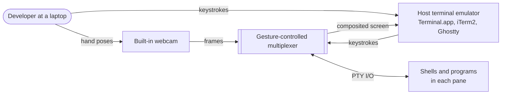
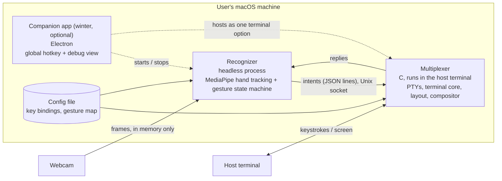
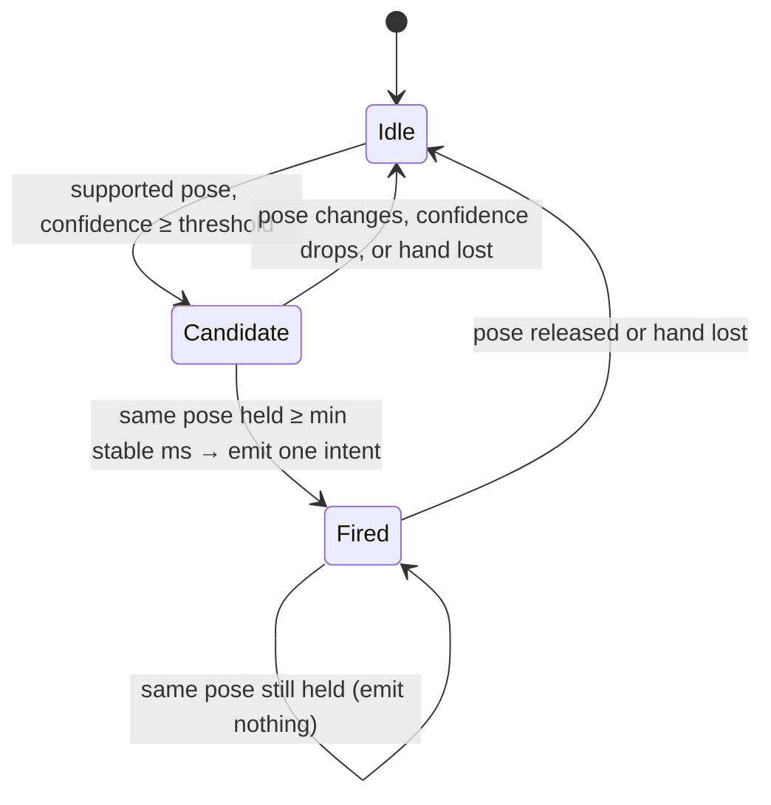
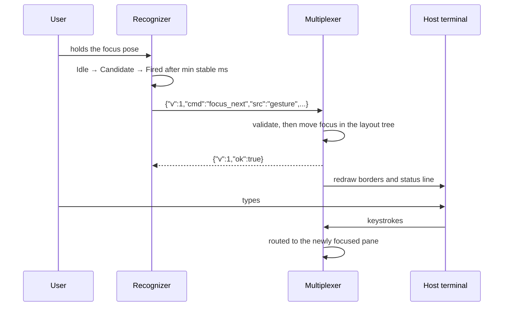

# Workshop 4: Peer Technical Design Review

Project 60: Vision-Based Gesture Control for Terminal Multiplexers

Farzaan Wadiwalla <wadiwalf@oregonstate.edu>, Havel Konda <kondah@oregonstate.edu>, Justin Lee <leeju8@oregonstate.edu>, Tobias Kohn <kohnto@oregonstate.edu>

---

**Reviewer:** Claude Code Opus 5.5 (AI agent)

## Review questions and answers

### 1. Is the problem and scope clear enough to judge the design?

Yes. The overview, the scope boundary (navigation and layout only), and the non-goals in `requirements.md` make it clear what the design must do and what it must not do. The walking skeleton is defined as one action, FR-5 focus between two panes, which keeps the fall target small.

### 2. Are the components and their boundaries clear?

Mostly. The three containers have one owner each and one-directional dependencies: the multiplexer depends on nothing, and it works by keyboard alone (FR-10). The five modules inside the multiplexer are a sensible split, and routing key bindings and socket intents through one command function is a good choice. One boundary is unclear: FR-13 makes the multiplexer's key binding turn recognition off and release the camera, but the protocol only carries requests from the recognizer to the multiplexer. Nothing lets the multiplexer tell the recognizer to stop (RC-3).

### 3. Is the intent protocol specified well enough for both sides to be built independently?

It is close. Transport, framing, fields, commands, and error codes are all defined, and putting confidence in the recognizer keeps the multiplexer simple. Several behaviors that the snapshot test will freeze are still unspecified: whether unknown extra fields are ignored or rejected (RC-4), what happens with more than one client connected, or when a stale socket file is left from a crash (RC-5), and whether there is a maximum line length (RC-11). The schema file, snapshot test, and CODEOWNERS entry were due 2026-11-10 and are not in the repository yet, so the R-4 trigger has fired (RC-1).

### 4. What happens when a part fails? Is that handled?

The "When a part fails" section covers the four main cases well. Dropping commands rather than queuing them while disconnected is the right call. One failure inside the recognizer is not covered: a single lost-tracking frame during a held pose takes the state machine from Fired to Idle, and the next frame can fire again, which breaks FR-3 (RC-2).

### 5. What are the biggest technical risks, and does the design address them?

The terminal core (R-5) and the schedule. The design says the skeleton's terminal core handles "only the escape sequences a shell prompt needs", but two panes side by side cannot be a pass-through: the compositor needs a cell grid, and the default macOS zsh prompt already uses cursor movement, erase, and color sequences (RC-6). Several decisions also land on the same few days just before Thanksgiving week: the recognizer language and packaging, the camera permission spike, and the first pre-release are due 2026-11-22, while the VT parsing decision and the compositor measurement are due 2026-11-24, after that pre-release (RC-7).

### 6. Can the design be tested the way it says?

Yes for the recognizer: synthetic label/confidence/timestamp sequences and landmark fixtures need no camera and respect constraint C-4 in the requirements. For the multiplexer, the integration test relies on a "headless multiplexer", but the design does not say what headless means for a program that writes to a host terminal (RC-8). NFR-1 latency is hard to measure from the logs, because intents carry no timestamp (RC-3, RC-9).

### 7. What is missing or unclear?

- Who writes the SM-2 command log, the recognizer or the multiplexer (RC-10).
- How `next_layout` maps existing panes onto a preset with a different number of slots. This is already deferred and does not block the skeleton.
- Whether the tmux CLI could serve as a fallback if the C terminal core runs long (RC-12).

### 8. What would you change first?

Land the schema file, snapshot test, and CODEOWNERS (RC-1) and settle the unspecified protocol behaviors (RC-3, RC-4, RC-5) in the same pull request, because the protocol is the most expensive thing to change later. Then add release debounce to the state machine (RC-2) and rewrite the terminal core scope for the skeleton (RC-6).

## Comment log

Priority: **P1** = before the first pre-release (2026-11-22). **P2** = before the RFC final. **P3** = later or when convenient. **Declined** = not acted on, with the reason.

| ID    | Section                               | Comment                                                                                                                                                                                                                                                              | Priority | Action or reason                                                                                                                                                                                                           |
| ----- | ------------------------------------- | -------------------------------------------------------------------------------------------------------------------------------------------------------------------------------------------------------------------------------------------------------------------- | -------- | -------------------------------------------------------------------------------------------------------------------------------------------------------------------------------------------------------------------------- |
| RC-1  | Interfaces, intent protocol           | The schema file, snapshot test, and CODEOWNERS entry were due 2026-11-10 and do not exist. The R-4 trigger has fired, and design.md still calls the protocol a draft.                                                                                                | P1       | Add the schema file, snapshot test, and CODEOWNERS in one PR approved by Farzaan and Justin. Update the design.md status line.                                                                                             |
| RC-2  | Gesture state machine                 | Fired → Idle on "hand lost" with no debounce means a single dropped frame during a hold re-arms the machine and can fire twice (breaks FR-3). A one-frame confidence dip in Candidate also resets the stability timer.                                               | P1       | Add a configurable release time: the pose must be absent for at least N ms before Fired → Idle. Add a test with a one-frame dropout. RFC-003 owner reviews.                                                                |
| RC-3  | Interfaces; FR-13                     | The protocol only runs recognizer → multiplexer, so the multiplexer's FR-13 toggle has no way to make the recognizer release the camera.                                                                                                                             | P2       | Decide the direction: either the multiplexer sends a `recognition_off` / `recognition_on` message on the open connection, or the toggle lives in the recognizer. Record it as an ADR, since it changes the protocol (R-4). |
| RC-4  | Interfaces, intent protocol           | Not specified whether unknown extra fields are ignored or rejected with `invalid_field`. This decides whether optional fields can be added in v1 without a version bump.                                                                                             | P1       | State "unknown fields are ignored" in design.md and in the schema before the snapshot freezes it.                                                                                                                          |
| RC-5  | Interfaces, transport                 | No rule for a second client connecting, a second multiplexer starting, or a stale `control.sock` left after a crash.                                                                                                                                                 | P2       | Specify: on startup, if connecting to an existing socket succeeds, refuse to start; otherwise unlink and recreate it. Allow one client at a time.                                                                          |
| RC-6  | Inside the multiplexer, terminal core | "Only the escape sequences a shell prompt needs" is too vague for a two-pane skeleton. A compositor needs a cell grid per pane, and the default zsh prompt uses cursor movement, erase, and SGR color. The `terminal-emulator/` spike is a single-pane pass-through. | P1       | List the minimum sequence set for the skeleton in design.md (CUP, cursor moves, ED/EL, SGR, CR/LF/BS), or move the R-5 contingency (libvterm) earlier.                                                                     |
| RC-7  | Deferred decisions; deployment        | The recognizer language, packaging, camera permission spike, and first pre-release all fall on 2026-11-22, and the VT decision and compositor measurement fall on 2026-11-24, after the pre-release. Week 9 is Thanksgiving.                                         | P1       | Move the VT decision and compositor measurement before 2026-11-22, or state that the first pre-release ships with the minimal core. Update the dates in design.md and risks.md.                                            |
| RC-8  | Testing                               | The multiplexer integration test uses a "headless multiplexer", which is not defined.                                                                                                                                                                                | P2       | Describe it: for example, run the multiplexer under a pseudo-terminal in CI, or add a flag that skips the compositor and dumps the layout tree.                                                                            |
| RC-9  | Interfaces; NFR-1                     | Intents carry no timestamp, so the 300 ms latency budget cannot be measured from the logs.                                                                                                                                                                           | P3       | Add an optional `ts` field (milliseconds, set when the pose becomes stable). Depends on RC-4.                                                                                                                              |
| RC-10 | Data                                  | The SM-2 command log is listed, but its writer is not named.                                                                                                                                                                                                         | P3       | Name the multiplexer as the writer, since it sees both gesture and keyboard commands.                                                                                                                                      |
| RC-11 | Interfaces, framing                   | No maximum line length, so a client that never sends a newline grows the read buffer without bound.                                                                                                                                                                  | P3       | Set a limit (for example 4 KiB) and reply `bad_json` past it.                                                                                                                                                              |
| RC-12 | Architecture                          | As a safety net for R-5, drive tmux through its CLI instead of writing a terminal core.                                                                                                                                                                              | Declined | ADR-0001 chose to build our own C multiplexer, and wrapping tmux would replace that architecture. An architectural change needs a team vote and a new ADR. R-5 already has a contingency (vendor libvterm).                |

---

# Technical Design Document

Project 60: Vision-Based Gesture Control for Terminal Multiplexers. Requirements: [`docs/requirements.md`](requirements.md). Risks: [`docs/risks.md`](risks.md).

## Overview

A terminal multiplexer written in C runs inside the terminal emulator the user already has, the way tmux does. A separate, headless recognizer process watches the built-in webcam, turns a deliberate hand pose into one pane command, and sends it to the multiplexer over a local socket. The keyboard keeps doing all the typing, and every gesture command also has a key binding (FR-10). An optional Electron companion app adds a system-wide hotkey and a debug view (FR-14). It is planned for winter and is not part of the walking skeleton.

The architecture is the hybrid option in [RFC-001](rfcs/2026-10-25-rfc-draft-justin.md), which the team chose ([ADR-0001](adr/0001-hybrid-multiplexer-architecture.md)). The reasons, and the options it rejected (an Electron-only GUI, a native multiplexer with no companion app, and deferring the decision), are in that RFC.

## What exists today

Only the checkpoint scaffold in `playground/mediapipe-example` runs. It is a spike: an Electron window that runs MediaPipe's gesture recognizer on the webcam and uses the result to pick a color. CI (`.github/workflows/ci.yml`) launches it on macOS and runs two camera-free UI tests. None of the components below exist yet, and the scaffold is not one of them. Its finding (MediaPipe's predefined gestures run in real time on a team laptop) goes into an ADR, and then the scaffold is deleted.

## Architecture

### C4 level 1: system context



The system has no network dependency and no account. Everything runs on the user's machine (NFR-5).

### C4 level 2: containers



| Container     | Responsibility                                                                                                                                                                                                                  | Owner                 |
| ------------- | ------------------------------------------------------------------------------------------------------------------------------------------------------------------------------------------------------------------------------- | --------------------- |
| Recognizer    | Reads webcam frames, tracks the hand, and runs the gesture state machine. Emits at most one intent per deliberate gesture (FR-1 to FR-4, FR-8 thresholds). It never writes or sends a frame.                                    | Farzaan Wadiwalla     |
| Multiplexer   | Spawns a PTY per pane and keeps each pane's screen state. Owns the layout and focus. Composites the panes into the host terminal, routes keystrokes, and executes intents from the socket or from key bindings (FR-5 to FR-13). | Justin Lee            |
| Companion app | Optional. Registers a system-wide hotkey that starts the recognizer and opens a debug view (FR-14). The multiplexer never depends on it.                                                                                        | Not assigned (winter) |

**Dependencies between containers.** The multiplexer depends on nothing else: with no recognizer running it is an ordinary keyboard-driven multiplexer (FR-10). The recognizer is useful only while a multiplexer is listening. The companion app depends on both.

### Inside the multiplexer

One process with five modules. Each can be tested without a real terminal (NFR-7).

- **PTY manager:** forks a login shell per pane and reads and writes its PTY.
- **Terminal core:** interprets each pane's output into a grid of cells. For the walking skeleton this handles only the escape sequences a shell prompt needs (R-5). Full VT parsing is a deferred decision, below.
- **Layout tree:** a binary tree of splits whose leaves are panes. It also holds the focused pane and the active preset layout. Every intent is applied as one operation on this tree.
- **Compositor:** draws the pane grids, borders, and status line into the host terminal, and redraws on output, resize, or a layout change.
- **Input router:** sends keystrokes to the focused pane, except the prefix key and its bindings. It also reads the intent socket. Key bindings and socket intents go through the same command function, so both paths behave identically.

## Interfaces

### Intent protocol (recognizer to multiplexer)

This is the contract three components build against, so it is the most expensive thing in this document to change (R-4). It is a **draft until both container owners approve it** in the pull request that adds the schema file and its snapshot test, due 2026-11-10. After that, any change needs both owners' review through CODEOWNERS.

- **Transport:** a Unix domain socket at `$TMPDIR/gesturemux-$UID/control.sock`, in a directory with mode `0700`, so only the user running the multiplexer can connect (NFR-6).
- **Framing:** one JSON object per line, UTF-8. The multiplexer writes exactly one reply line per request line.
- **Request:**

  ```json
  { "v": 1, "cmd": "focus_next", "src": "gesture", "gesture": "Pointing_Up" }
  ```

  | Field     | Required | Meaning                                                                     |
  | --------- | -------- | --------------------------------------------------------------------------- |
  | `v`       | yes      | Protocol version, an integer. Version 1 is the only one so far.             |
  | `cmd`     | yes      | One of the commands below.                                                  |
  | `src`     | no       | `"gesture"` or `"keyboard"`. Used only for feedback and the command log.    |
  | `gesture` | no       | The pose label that produced the command, shown in the status line (FR-12). |

  | `cmd`         | Effect                                                                     | Requirement |
  | ------------- | -------------------------------------------------------------------------- | ----------- |
  | `focus_next`  | Move focus to the next pane in tree order, wrapping at the end.            | FR-5        |
  | `split_pane`  | Split the focused pane, start a login shell in the new pane, and focus it. | FR-6        |
  | `next_layout` | Apply the next preset layout. No pane's process restarts.                  | FR-7        |
  | `close_pane`  | Close the focused pane and end its process.                                | FR-8        |

- **Reply:** `{"v": 1, "ok": true}` or `{"v": 1, "ok": false, "error": "<code>"}`, where `<code>` is `bad_json`, `unsupported_version`, `unknown_command`, or `invalid_field`. On any error the layout is unchanged (FR-9).
- **Confidence stays in the recognizer.** The recognizer applies the thresholds before sending, including the higher one for `close_pane`. The multiplexer trusts that any well-formed intent is deliberate.

### Gesture state machine (inside the recognizer)

Continuous per-frame results become single commands here. This follows [RFC-003](rfcs/2026-10-25-rfc-draft-havel.md), which is still Proposed. If the team rejects it, this section changes and the protocol does not.



Time is measured from frame timestamps, not frame counts, so the machine behaves the same at 15 fps and 30 fps (FR-4). The threshold, the destructive-command threshold, and the stability time are config values, not constants.

### Key scenario: focus the next pane (the walking skeleton)



### When a part fails

- **Recognizer crashes or the camera disappears:** no intents arrive, and the multiplexer keeps working by keyboard (FR-10).
- **Multiplexer is not running:** the recognizer retries the connection every second and **drops** commands until it connects. It never queues them, so a stale gesture cannot fire minutes later.
- **Malformed intent:** rejected with an error reply, and the layout is unchanged (FR-9).
- **Companion app crashes:** the multiplexer and recognizer keep running (FR-14).

## Data

| Data                                    | Where it lives                             | Lifetime                                                                                     |
| --------------------------------------- | ------------------------------------------ | -------------------------------------------------------------------------------------------- |
| Camera frames                           | Recognizer memory only                     | One frame. Never written to disk or sent anywhere (NFR-5, C-4).                              |
| Hand landmarks, pose label, confidence  | Recognizer memory                          | Transient. Recorded landmark sequences are the test fixtures, committed as coordinates only. |
| Layout tree, focused pane, pane grids   | Multiplexer memory                         | The life of the multiplexer. Nothing is persisted, and detach/reattach is a non-goal.        |
| Command log (label, command, timestamp) | A local file, off by default               | Only when switched on for SM-2 measurement. Contains no frames and no terminal contents.     |
| Key bindings and gesture-to-command map | Config file in the user's config directory | Persistent, edited by the user (FR-15). Format is deferred.                                  |

Terminal contents can include secrets, so they never leave the multiplexer process and are not logged.

## Deployment

**Production target.** The fall walking skeleton is a macOS build of the multiplexer and recognizer, published on the GitHub Releases page of `just1nlee/osu-capstone`. It counts as deployed when a person outside the team downloads it onto their own Mac, installs it by following the release notes alone, and completes the FR-5 focus action (NFR-8, SM-3), by fall week 10 (2026-11-30 to 2026-12-06). The skeleton is the thinnest end-to-end slice: one gesture moves focus between two panes (R-1). The companion app is not in it. Justin Lee owns the GitHub repository and its Releases. Havel Konda finds the outside volunteer (R-13). Prof. Guyer, standing in for a partner on this student-proposed project, was asked to agree this target on 2026-11-01 and is expected to confirm it at the mentor meeting on 2026-11-03 (R-12). Builds are unsigned this fall, so the release notes include the one step needed to open an unsigned app on macOS (R-9, C-7).

**Where changes are tried first.** Every pull request runs CI. Each release candidate is published as a GitHub pre-release and installed on a team laptop other than its author's before it is promoted. The first pre-release is due 2026-11-22. The full gate and rollback plan is the safety-net plan in `docs/risks.md`.

**Runtime shape.** The user starts the multiplexer in their terminal, and it creates the socket. The recognizer is started separately, or later by the companion app. macOS asks for camera permission on first use.

## Deferred decisions

Each is deferred on purpose because it is cheap to reverse or not needed for the skeleton. Each gets an ADR when it is made.

- **VT parsing: our own parser or a library (libvterm or libghostty-vt).** The skeleton's terminal core handles only a shell prompt. Decided by the R-5 trigger date, 2026-11-24.
- **The recognizer's language and how it is packaged** into a release that installs on a machine without a development setup. Needed before the first pre-release, 2026-11-22.
- **Gesture classification: MediaPipe's predefined gestures or our own classifier on landmarks.** This is an open question in the requirements, answered by the R-2 spike. Only the recognizer's internals change, because the intent protocol does not carry poses as commands.
- **Which pose maps to which command.** It is a config value, so it can change without touching code.
- **Preset layouts for `next_layout`:** which ones, and in what order.
- **Config file format and location** (FR-15).
- **The companion app's internals**, including how the debug view receives frames without breaking NFR-5. Winter.
- **Linux support and code signing.** These are open questions in the requirements and R-9.

## Open technical questions

- **Is the compositor fast enough?** Can it redraw several busy panes within NFR-2's 2× bound? Measure it on the skeleton with a 10 MB `cat`. Owner: Justin Lee, by 2026-11-24.
- **Which app owns the camera permission?** On macOS, a process started from a terminal may have its camera permission attributed to the terminal emulator rather than the recognizer, which would change the install steps. Spike it before the first pre-release. Owner: Farzaan Wadiwalla, by 2026-11-22.
- **Is cell-based feedback clear enough?** Can a user see which pane has focus and what command just ran from borders and a status line alone (FR-12)? Answered in the first team testing of the skeleton. Owner: Havel Konda.
- **Does the frame rate hold?** Do team laptops' webcams sustain the frame rate that NFR-1's latency budget assumes in normal lighting? This is the R-2 spike. Owner: Farzaan Wadiwalla, by 2026-11-17.

## Testing

- **Recognizer:** unit-test the state machine and thresholds with synthetic label/confidence/timestamp sequences, and the recognition path with recorded landmark fixtures. No camera is needed (NFR-7).
- **Multiplexer:** unit-test layout-tree operations and intent validation. Integration-test by replaying intent lines into the socket of a headless multiplexer and comparing the resulting layout tree to the expected one. No host terminal or display is needed.
- **Protocol:** a snapshot test of the schema file fails on any change, so a contract change cannot merge unnoticed (R-4).
- **Manual, per release:** live webcam recognition, rendering `vim` and `btop` in two host terminals (FR-11), and the outside install (NFR-8).
