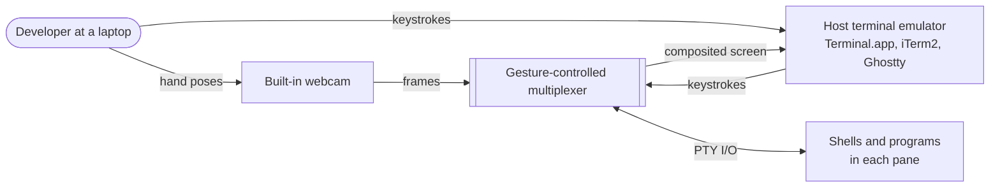
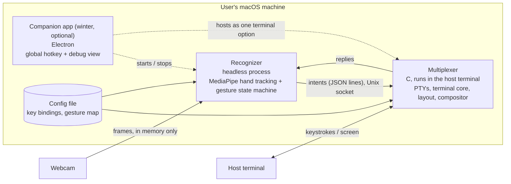
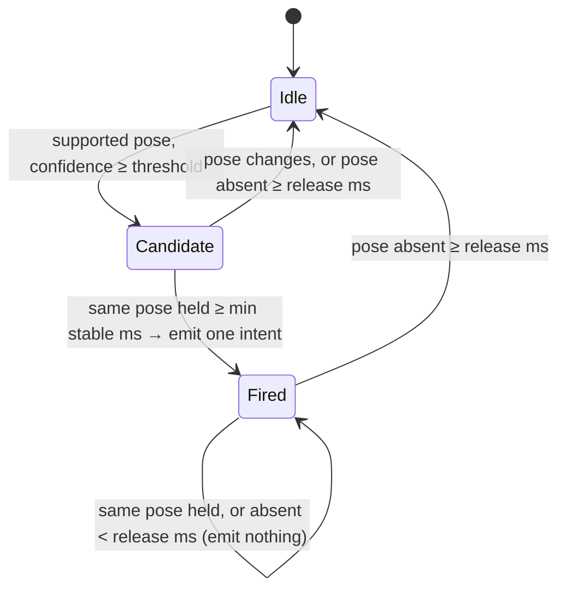
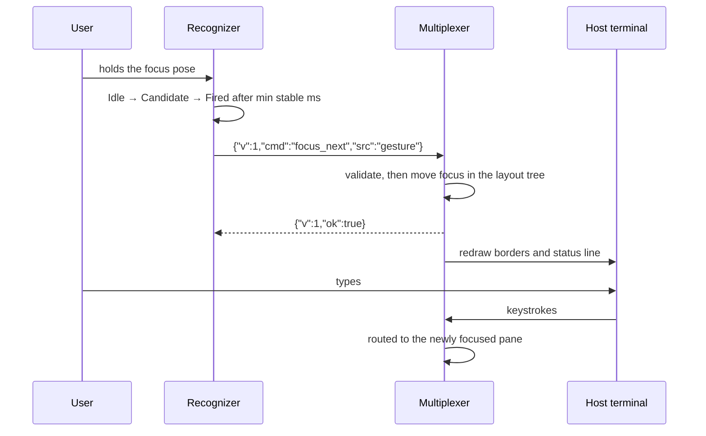

# Design

Project 60: Vision-Based Gesture Control for Terminal Multiplexers. Requirements: [`docs/requirements.md`](requirements.md). Risks: [`docs/risks.md`](risks.md).

## Overview

A terminal multiplexer written in C runs inside the terminal emulator the user already has, the way tmux does. A separate, headless recognizer process watches the built-in webcam, turns a deliberate hand pose into one pane command, and sends it to the multiplexer over a local socket. The keyboard keeps doing all the typing, and every gesture command also has a key binding (FR-10). An optional Electron companion app adds a system-wide hotkey and a debug view (FR-14). It is planned for winter and is not part of the walking skeleton.

The architecture is the hybrid option in [RFC-001](rfcs/2026-11-22-rfc-final-justin.md), which the team chose ([ADR-0001](adr/0001-hybrid-multiplexer-architecture.md)). The reasons, and the options it rejected (an Electron-only GUI, a native multiplexer with no companion app, and deferring the decision), are in that RFC.

## What exists today

Two early pieces of the multiplexer exist under `terminal-emulator/`: `main.c` runs one shell in a PTY, and `bus/` is the command bus. The bus implements the intent protocol below, but for now it only prints each command it receives (`bin/command-bus`). Apart from those, only the checkpoint scaffold in `playground/mediapipe-example` runs. It is a spike: an Electron window that runs MediaPipe's gesture recognizer on the webcam and uses the result to pick a color. CI (`.github/workflows/ci.yml`) launches it on macOS and runs two camera-free UI tests. None of the components below is complete yet, and the scaffold is not one of them. Its finding (MediaPipe's predefined gestures run in real time on a team laptop) goes into an ADR, and then the scaffold is deleted.

## Architecture

### C4 level 1: system context



The system has no network dependency and no account. Everything runs on the user's machine (NFR-5).

### C4 level 2: containers



| Container | Responsibility | Owner |
| --- | --- | --- |
| Recognizer | Reads webcam frames, tracks the hand, and runs the gesture state machine. Emits at most one intent per deliberate gesture (FR-1 to FR-4, FR-8 thresholds). It never writes or sends a frame. | Farzaan Wadiwalla |
| Multiplexer | Spawns a PTY per pane and keeps each pane's screen state. Owns the layout and focus. Composites the panes into the host terminal, routes keystrokes, and executes intents from the socket or from key bindings (FR-5 to FR-13). | Justin Lee |
| Companion app | Optional. Registers a system-wide hotkey that starts the recognizer and opens a debug view (FR-14). The multiplexer never depends on it. | Not assigned (winter) |

**Dependencies between containers.** The multiplexer depends on nothing else: with no recognizer running it is an ordinary keyboard-driven multiplexer (FR-10). The recognizer is useful only while a multiplexer is listening. The companion app depends on both.

### Inside the multiplexer

One process with five modules. Each can be tested without a real terminal (NFR-7).

- **PTY manager:** forks a login shell per pane and reads and writes its PTY.
- **Terminal core:** interprets each pane's output into a grid of cells. Each pane keeps its own grid, even in the skeleton, because the compositor draws two panes side by side and cannot pass a pane's output straight through. For the walking skeleton the core handles only what the default macOS zsh prompt and line editing emit (R-5):

  - C0 controls: CR, LF, BS, HT, and BEL (ignored).
  - Cursor movement: CUP (`ESC [ row ; col H`), CUU, CUD, CUF, and CUB.
  - Erase: ED (`ESC [ J`) and EL (`ESC [ K`).
  - SGR (`ESC [ … m`): reset, bold, and the 16 basic colors. Other attributes are parsed and ignored.
  - Any other escape sequence is consumed and ignored, so it never prints as text.

  Full-screen programs such as `vim` and `btop` (FR-11) need more than this, so full VT parsing is a deferred decision, below.
- **Layout tree:** a binary tree of splits whose leaves are panes. It also holds the focused pane and the active preset layout. Every intent is applied as one operation on this tree.
- **Compositor:** draws the pane grids, borders, and status line into the host terminal, and redraws on output, resize, or a layout change.
- **Input router:** sends keystrokes to the focused pane, except the prefix key and its bindings. It also reads the intent socket. Key bindings and socket intents go through the same command function, so both paths behave identically.

## Interfaces

### Intent protocol (recognizer to multiplexer)

This is the contract three components build against, so it is the most expensive thing in this document to change (R-4). It is a **draft until both container owners approve it** in the pull request that adds the schema file, its snapshot test, and the CODEOWNERS entry. That pull request was due 2026-11-10 and has not merged, so the R-4 trigger has fired. Until it merges, nothing should be built against this protocol beyond the walking skeleton's `focus_next`. After it merges, any change needs both owners' review through CODEOWNERS.

- **Transport:** a Unix domain socket at `$TMPDIR/gesturemux-$UID/control.sock`, in a directory with mode `0700`, so only the user running the multiplexer can connect (NFR-6).
- **Socket lifecycle:** on startup the multiplexer tries to connect to an existing `control.sock`. If that succeeds, another multiplexer owns it, so this one exits with an error. If it fails, the file is stale from a crash, so the multiplexer removes it and creates a new one. It removes the socket on a clean exit.
- **Multiple clients:** the multiplexer accepts up to 16 connections at once, for example a recognizer and a keyboard client, so a demo can switch between input modes without reconnecting. Further connections are closed. Commands run one at a time in the order they arrive, whichever client sent them. Each request line is executed and answered before the next line is read, so an `ok` reply means the command has run. There is no queue: nothing waits to run later. A client that disconnects mid-line loses only that partial line.
- **Framing:** one JSON object per line, UTF-8. The multiplexer writes exactly one reply line per request line. A line longer than 4 KiB is discarded up to its newline and gets a `bad_json` reply, so a client that never sends a newline cannot grow the read buffer without bound.
- **Unknown fields are ignored.** A request may carry fields not listed below, and the multiplexer ignores them. This lets an optional field be added within version 1 without a version bump. A missing required field, or a listed field with the wrong type or value, is still `invalid_field`.
- **Request:**

  ```json
  {"v": 1, "cmd": "split_pane", "dir": "right", "src": "gesture"}
  ```

  | Field | Required | Meaning |
  | --- | --- | --- |
  | `v` | yes | Protocol version, an integer. Version 1 is the only one so far. |
  | `cmd` | yes | One of the commands below. |
  | `dir` | for `focus` and `split_pane` | `"left"`, `"right"`, `"up"`, or `"down"`. Ignored on other commands. |
  | `src` | no | `"gesture"` or `"keyboard"`. Used only for feedback and the command log. |

  The protocol carries no pose label. Which pose produced a command stays inside the recognizer, so the multiplexer's feedback (FR-12) shows the command, not the gesture. FR-12's wording still asks for the recognized gesture and needs updating to match.

  | `cmd` | Effect | Requirement |
  | --- | --- | --- |
  | `focus` | Move focus to the nearest pane in direction `dir`. | FR-5 |
  | `focus_next` | Move focus to the next pane in tree order, wrapping at the end. | FR-5 |
  | `split_pane` | Split the focused pane so the new pane opens on the `dir` side, start a login shell in it, and focus it. | FR-6 |
  | `next_layout` | Apply the next preset layout. No pane's process restarts. | FR-7 |
  | `close_pane` | Close the focused pane and end its process. | FR-8 |

- **Reply:** `{"v": 1, "ok": true}` or `{"v": 1, "ok": false, "error": "<code>"}`, where `<code>` is `bad_json`, `unsupported_version`, `unknown_command`, or `invalid_field`. On any error the layout is unchanged (FR-9).
- **Confidence stays in the recognizer.** The recognizer applies the thresholds before sending, including the higher one for `close_pane`. The multiplexer trusts that any well-formed intent is deliberate.

### Gesture state machine (inside the recognizer)

Continuous per-frame results become single commands here. This follows [RFC-003](rfcs/2026-10-25-rfc-draft-havel.md), which is still Proposed. If the team rejects it, this section changes and the protocol does not.



"Absent" means a frame where the pose is not seen: tracking lost, no hand, or confidence below the threshold. A short dropout during a hold is normal, so a pose counts as released only after it has been absent for the release time. Without that, one lost frame during a held gesture would re-arm the machine and fire a second command, breaking FR-3. In Candidate, a dropout shorter than the release time does not reset the stability timer. A *different* supported pose above the threshold is not a dropout, and it moves Candidate back to Idle at once.

Time is measured from frame timestamps, not frame counts, so the machine behaves the same at 15 fps and 30 fps (FR-4). The threshold, the destructive-command threshold, the stability time, and the release time are config values, not constants. The unit tests include a held pose with a one-frame dropout, which must emit exactly one command.

### Key scenario: focus the next pane (the walking skeleton)



### When a part fails

- **Recognizer crashes or the camera disappears:** no intents arrive, and the multiplexer keeps working by keyboard (FR-10).
- **Multiplexer is not running:** the recognizer retries the connection every second and **drops** commands until it connects. It never queues them, so a stale gesture cannot fire minutes later.
- **Malformed intent:** rejected with an error reply, and the layout is unchanged (FR-9).
- **Companion app crashes:** the multiplexer and recognizer keep running (FR-14).

## Data

| Data | Where it lives | Lifetime |
| --- | --- | --- |
| Camera frames | Recognizer memory only | One frame. Never written to disk or sent anywhere (NFR-5, C-4). |
| Hand landmarks, pose label, confidence | Recognizer memory | Transient. Recorded landmark sequences are the test fixtures, committed as coordinates only. |
| Layout tree, focused pane, pane grids | Multiplexer memory | The life of the multiplexer. Nothing is persisted, and detach/reattach is a non-goal. |
| Command log (label, command, timestamp) | A local file written by the multiplexer, off by default | Only when switched on for SM-2 measurement. The multiplexer writes it because it sees both gesture and keyboard commands. Contains no frames and no terminal contents. |
| Key bindings and gesture-to-command map | Config file in the user's config directory | Persistent, edited by the user (FR-15). Format is deferred. |

Terminal contents can include secrets, so they never leave the multiplexer process and are not logged.

## Deployment

**Production target.** The fall walking skeleton is a macOS build of the multiplexer and recognizer, published on the GitHub Releases page of `just1nlee/osu-capstone`. It counts as deployed when a person outside the team downloads it onto their own Mac, installs it by following the release notes alone, and completes the FR-5 focus action (NFR-8, SM-3), by fall week 10 (2026-11-30 to 2026-12-06). The skeleton is the thinnest end-to-end slice: one gesture moves focus between two panes (R-1). The companion app is not in it. Justin Lee owns the GitHub repository and its Releases. Havel Konda finds the outside volunteer (R-13). Prof. Guyer, standing in for a partner on this student-proposed project, was asked to agree this target on 2026-11-01 and is expected to confirm it at the mentor meeting on 2026-11-03 (R-12). Builds are unsigned this fall, so the release notes include the one step needed to open an unsigned app on macOS (R-9, C-7).

**Where changes are tried first.** Every pull request runs CI. Each release candidate is published as a GitHub pre-release and installed on a team laptop other than its author's before it is promoted. The first pre-release is due 2026-11-22, and it ships with the skeleton's minimal terminal core described above, whatever the VT parsing decision on 2026-11-24 turns out to be. That pre-release is gated on FR-5 and the outside install, not on full-screen programs (FR-11) or output speed (NFR-2). The full gate and rollback plan is the safety-net plan in `docs/risks.md`.

**Runtime shape.** The user starts the multiplexer in their terminal, and it creates the socket. The recognizer is started separately, or later by the companion app. macOS asks for camera permission on first use.

## Deferred decisions

Each is deferred on purpose because it is cheap to reverse or not needed for the skeleton. Each gets an ADR when it is made.

- **VT parsing: our own parser or a library (libvterm or libghostty-vt).** The skeleton's terminal core handles only a shell prompt. Decided by the R-5 trigger date, 2026-11-24. This comes after the first pre-release on purpose: that pre-release ships with the minimal core, and the decision applies from the second pre-release on.
- **The recognizer's language and how it is packaged** into a release that installs on a machine without a development setup. Needed before the first pre-release, 2026-11-22.
- **Gesture classification: MediaPipe's predefined gestures or our own classifier on landmarks.** This is an open question in the requirements, answered by the R-2 spike. Only the recognizer's internals change, because the intent protocol does not carry poses as commands.
- **Which pose maps to which command.** It is a config value, so it can change without touching code.
- **Preset layouts for `next_layout`:** which ones, and in what order.
- **Config file format and location** (FR-15).
- **The companion app's internals**, including how the debug view receives frames without breaking NFR-5. Winter.
- **Linux support and code signing.** These are open questions in the requirements and R-9.

## Open technical questions

- **Which process owns the recognition toggle (FR-13)?** The multiplexer owns the key bindings, but the recognizer holds the camera, and the protocol has no message from the multiplexer to the recognizer. The options are in [ADR-0002](adr/0002-recognition-toggle-owner.md), which is Proposed. Decided by team vote before the RFC final.

- **Is the compositor fast enough?** Can it redraw several busy panes within NFR-2's 2× bound? Measure it on the skeleton with a 10 MB `cat`. Owner: Justin Lee, by 2026-11-24.
- **Which app owns the camera permission?** On macOS, a process started from a terminal may have its camera permission attributed to the terminal emulator rather than the recognizer, which would change the install steps. Spike it before the first pre-release. Owner: Farzaan Wadiwalla, by 2026-11-22.
- **Is cell-based feedback clear enough?** Can a user see which pane has focus and what command just ran from borders and a status line alone (FR-12)? Answered in the first team testing of the skeleton. Owner: Havel Konda.
- **Does the frame rate hold?** Do team laptops' webcams sustain the frame rate that NFR-1's latency budget assumes in normal lighting? This is the R-2 spike. Owner: Farzaan Wadiwalla, by 2026-11-17.

## Testing

- **Recognizer:** unit-test the state machine and thresholds with synthetic label/confidence/timestamp sequences, and the recognition path with recorded landmark fixtures. No camera is needed (NFR-7).
- **Multiplexer:** unit-test layout-tree operations and intent validation. Integration-test by replaying intent lines into the socket of a headless multiplexer and comparing the resulting layout tree to the expected one. **Headless** means the test harness starts the multiplexer on a pseudo-terminal it owns instead of a real host terminal, with a test-only flag that makes the multiplexer write its layout tree and focused pane as JSON to a file after each command. The harness reads that file and discards the screen output. No host terminal or display is needed.
- **Protocol:** a snapshot test of the schema file fails on any change, so a contract change cannot merge unnoticed (R-4).
- **Manual, per release:** live webcam recognition, rendering `vim` and `btop` in two host terminals (FR-11), and the outside install (NFR-8).
